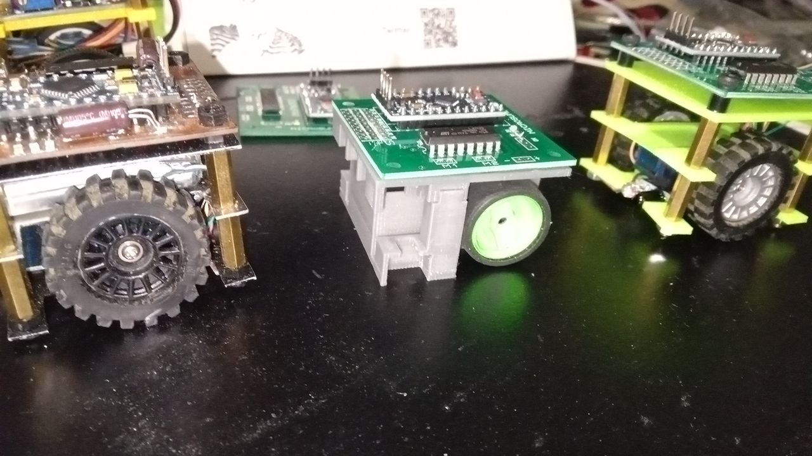
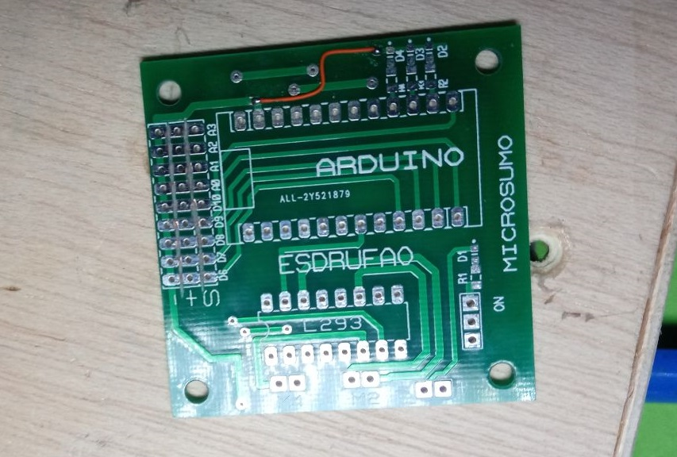
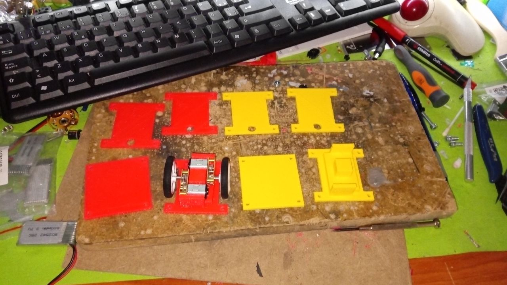
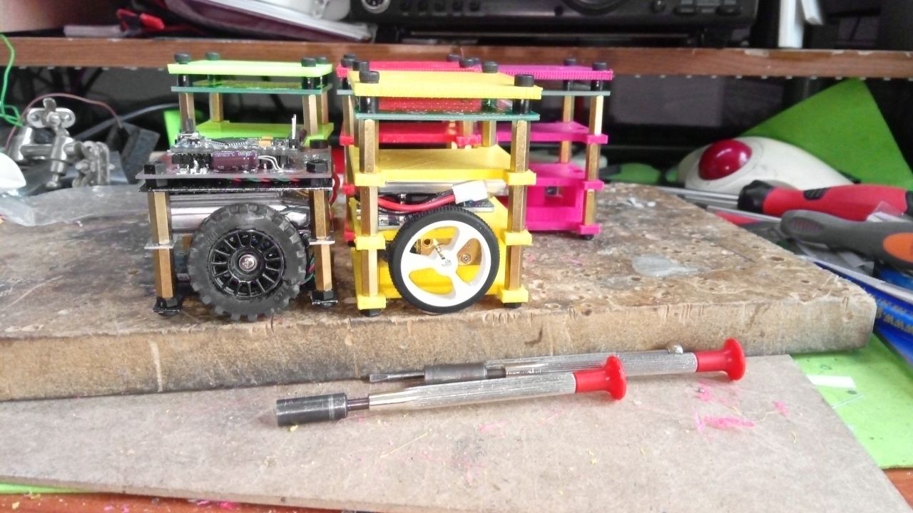
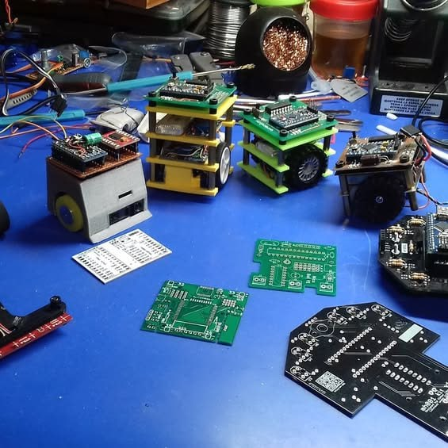

# Centeno

Robot de **Microsumo** (5×5×5 cm, < 100 g): **el primer microsumo de Esdrufao**
(~2018). El nombre le viene de que **pesaba justo 100 gramos**, *"100 gramos de
centeno"*.

Nació **en su taller** y fue el punto de partida de toda la "moda" de microsumos
del grupo. Se construyó con una **placa fresada a CNC** y **chasis de chapa
metálica cortada**; por eso **no existe un modelo 3D** de su chasis
(ver [3d_model](./3d_model/)).

Esdrufao **ha compartido muchas placas** con el resto del grupo, así fue
creciendo la comunidad.

<table>
<tr>
<td>  </td>
</tr>
</table>

## Versiones

Centeno tuvo **tres iteraciones** (detalle en [docs/03-versiones.md](docs/03-versiones.md)):

| Versión | Nombre | Placa | Estado |
|---|---|---|---|
| **v0** | **uWorm** (microworm) | placa de topos (prototipo) | primer prototipo |
| **v1** | **Centeno** | fresada a CNC + chasis de chapa | funcional |
| **v1.2** | **Hormigas** | basada en la de Centeno | robot colaborativo |

- **v0, uWorm:** el primer prototipo, sobre **placa de topos** (entradas digitales/analógicas, salida de motores, DC-DC 3,7→6 V, Arduino, 3 LEDs rojo/naranja/verde y sensores **CNY70**). Fotos en [`images/uworm/`](images/uworm/).
- **v1, Centeno:** la versión funcional de la placa **fresada a CNC**.
- **v1.2, Hormigas:** **basada en la placa de Centeno**; idea de **robot colaborativo** (comunicación por RF 433 MHz/nRF y aunar fuerzas).

## Evolución del proceso

Centeno fue el origen de todo un **movimiento de microsumos**: a partir de él,
cada vez más makers del grupo se animaron a construir el suyo. En la foto se
puede ver la **evolución de las placas y los robots**, en orden:
**Centeno → Microsumo → Hormiga**.

<p align="center">
  
</p>

## Microsumo

**Microsumo** es la placa de la que salieron **varios microsumos del grupo**:
a partir de este diseño, cada uno montó su propio microsumo.

<p align="center">
  
</p>

## Hormigas

La versión **v1.2 (Hormigas)** lleva una placa basada en la de Centeno y está
pensada como **robot colaborativo** (detalle en [Versiones](docs/03-versiones.md)).

<p align="center">
  
  
  
</p>

## Hardware
- **Arduino Mini** (ATmega328P)
- **Driver de motores L293D** (doble puente H)
- 2× **motores** (conectores `M1`/`M2`), típicos N20
- **Sensores infrarrojos chinos** (módulos de reflexión **regulables**) → conectores de 3 pines en `D5`–`D9` / `A0`–`A3`
- 4× **LEDs de estado** (rojo, verde, amarillo, azul) con resistencias de 330 Ω
- Alimentación: **6 V** (entrada `J10` `6VDC`) o batería sobre `RAW`
- 3× condensadores de filtrado de 10 µF

Pinout completo en [docs/01-hardware.md](docs/01-hardware.md).

## Documentación

- [Hardware y pinout](docs/01-hardware.md), componentes, alimentación y conexionado
- [PCB](docs/02-pcb.md), esquema `centeno v1.0`, conectores y notas de fabricación
- [Versiones](docs/03-versiones.md), uWorm (v0), Centeno (v1) y las Hormigas (v1.2)

Documentación completa en [docs/index.md](docs/index.md).

## Estructura del repositorio

```
Centeno/
├── pcb_files/            # Esquemático centeno v1.0
├── 3d_model/             # Nota: Centeno no tiene modelo 3D (chasis de chapa)
├── images/               # Esquema, fotos de Centeno, uWorm (v0), Microsumo y Hormigas
└── docs/                 # Documentación
```

## Stack tecnológico

| Elemento          | Tecnología                        |
|-------------------|-----------------------------------|
| Microcontrolador  | ATmega328P (Arduino Mini)         |
| Driver de motores | L293D                             |
| Sensores          | módulos IR chinos (regulables)    |
| Diseño de PCB     | Proteus 8 (ARES)                  |
| Fabricación PCB   | fresado **CNC**                   |

## Créditos y licencia

- Diseño original (esquemático y placa): **Esdrufao** (Miguel Eirabella, ~2018).
- **Sin modelo 3D**: el chasis era de **chapa metálica cortada** (ver [3d_model](./3d_model/)).
- Documentación: licencia **GPL-3.0** (ver [LICENSE](LICENSE)).

## El movimiento

Como varios nos animamos a crear microsumos, al final Esdrufao decidió crear un
**kit** para que cualquiera pudiera tener un **modelo de iniciación**.

<p align="center">
  
</p>
