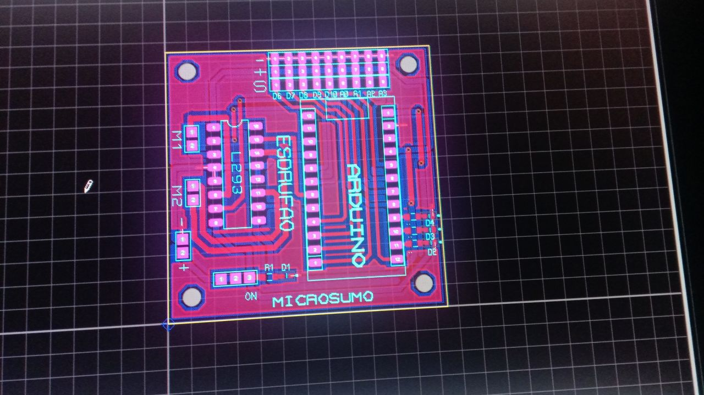
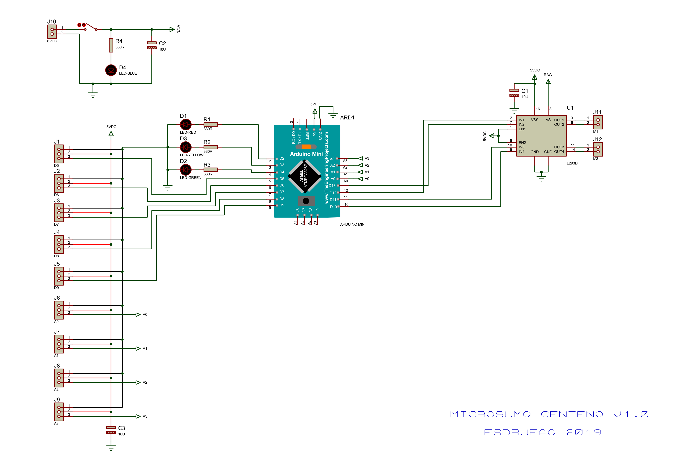

[← Volver al índice](index.md)

# 02, PCB

Documentación de la placa de **Centeno**, diseñada por **Esdrufao** en
**Proteus 8 (ARES)**.

## Fabricación

Centeno usa una **placa fresada a CNC**, con **chasis de chapa metálica
cortada**. Por eso **no hay gerbers ni layout** publicados en este repo: solo se
conserva el **esquemático**.

## Esquemático

| Archivo | Contenido |
|---|---|
| `pcb_files/centeno_v1.0_schematic.pdf` | Esquemático **Centeno v1.0** (hoja única) |
| `pcb_files/uworm_v0_schematic.pdf` | Esquemático del prototipo **uWorm v0** (Proteus `microsumo.pdsprj`, 10/03/2019) |
| `pcb_files/microsumo_v1.2_schematic.pdf` | Esquemático de la placa **v1.2** (microsumo, 14/05/2019) |

> El prototipo **uWorm (v0)** iba sobre **placa de topos**: Arduino, salida de
> motores, DC-DC 3,7→6 V, 3 LEDs (rojo/naranja/verde) y sensores **CNY70**
> (ver [Versiones](03-versiones.md)).

### Bloques del esquemático

- **`ARD1`**, Arduino Mini (ATmega328P).
- **`U1`**, L293D (driver de motores).
- **`D1`–`D4`**, 4 LEDs de estado (rojo / verde / amarillo / azul) con
  `R1`–`R4` de 330 Ω.
- **`J1`–`J9`**, conectores de 3 pines para los sensores IR, mapeados a
  `D5`, `D6`, `D7`, `D8`, `D9`, `A0`, `A1`, `A2`, `A3`.
- **`J10`**, entrada de alimentación `6VDC`.
- **`J11` / `J12`**, motores `M1` / `M2`.
- **`C1`–`C3`**, condensadores de 10 µF.

## Imágenes

- `images/pcb/centeno_v1.0_esquema.png`, render del esquemático.

## Notas

- El esquemático muestra el **nombre invertido** del autor como firma.
- Los **sensores** son módulos IR chinos **regulables**, enchufables (no fijos
  en placa).

---

[← 01 - Hardware y pinout](01-hardware.md)  |  [03 - Versiones →](03-versiones.md)
