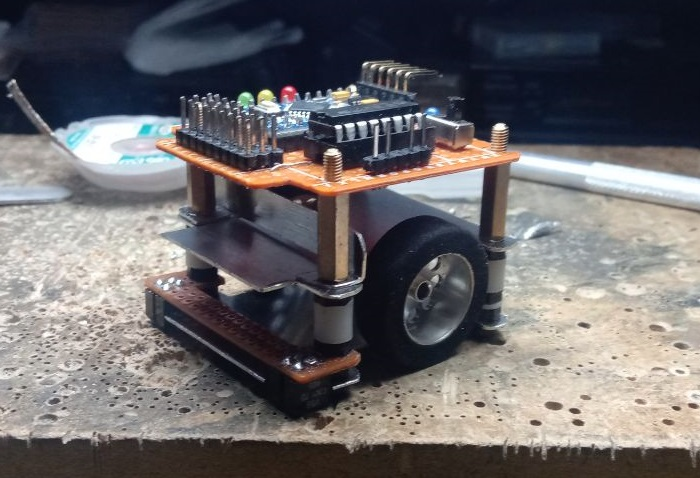
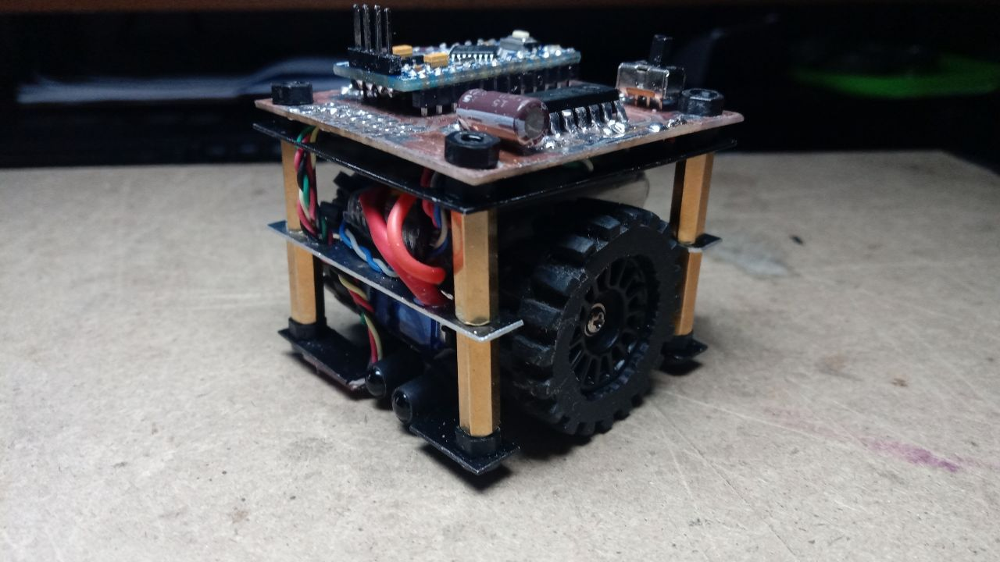
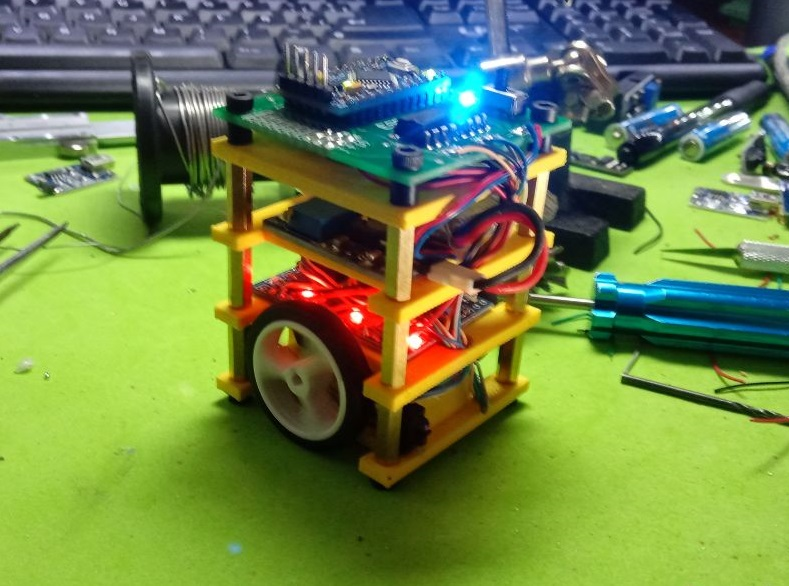

[← Volver al índice](index.md)

# 03, Versiones

Centeno tuvo **tres iteraciones**:

| Versión | Nombre | Placa | Estado |
|---|---|---|---|
| **v0** | **uWorm** (microworm) | placa de topos (prototipo) | primer prototipo |
| **v1** | **Centeno** | fresada a CNC + chasis de chapa | funcional |
| **v1.2** | **Hormigas** | basada en la de Centeno | robot colaborativo |

## v0, uWorm (microworm)

El **prototipo inicial**, montado sobre **placa de topos**. Llevaba:

  

- **entradas digitales y analógicas**;
- **salida de motores**;
- **DC-DC de 3,7 V → 6 V** para los motores;
- **Arduino**;
- **3 LEDs** (rojo, naranja, verde);
- sensores **CNY70**.

Fue un **prototipo** válido: el punto de partida de todo lo que vino después.

- Esquema: [`pcb_files/uworm_v0_schematic.pdf`](../pcb_files/uworm_v0_schematic.pdf)
  (Proteus `microsumo.pdsprj`, 10/03/2019).
- Fotos: [`images/uworm/`](../images/uworm/)

## v1, Centeno

La versión **funcional**: la placa se **fresó a CNC** y el **chasis era de chapa
metálica cortada**. Es el robot que da nombre al proyecto (pesaba **100 g**).

  

- Esquema: [`pcb_files/centeno_v1.0_schematic.pdf`](../pcb_files/centeno_v1.0_schematic.pdf)

## v1.2, Hormigas

La **placa v1.2** está **basada en la placa de Centeno (v1.0)** y es la que
equipa a las **hormigas**. La idea es un **robot colaborativo**: podrían
**comunicarse entre ellos**.

  

- Esquema: [`pcb_files/microsumo_v1.2_schematic.pdf`](../pcb_files/microsumo_v1.2_schematic.pdf)
- **Comunicación (prevista):** módulos **RF 433 MHz** (transmisor/receptor) por
  **puerto serie**, o bien módulos **nRF**. Al recibir la orden, los otros robots
  **dejan lo que están haciendo y vienen a ayudar a empujar** (una lata, una caja…),
  y viceversa.
- **Sensores:** un **frontal izquierdo** y un **frontal derecho** + uno **trasero**.
- **LEDs de estado:** **verde** = sensor derecho, **ámbar** = izquierdo,
  **rojo** = trasero; si actúan los dos frontales, se encienden ambos.
- La placa v1.2 tiene **huecos** para la alimentación y para los **módulos RF**.
- Chasis con inclinación ("pandeo") para ganar tracción.

---

[← 02 - PCB](02-pcb.md)
